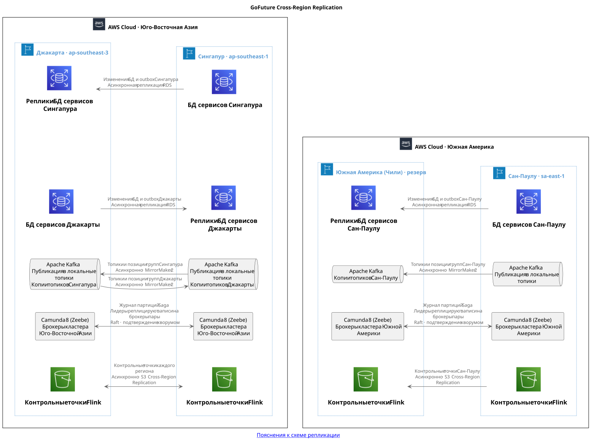
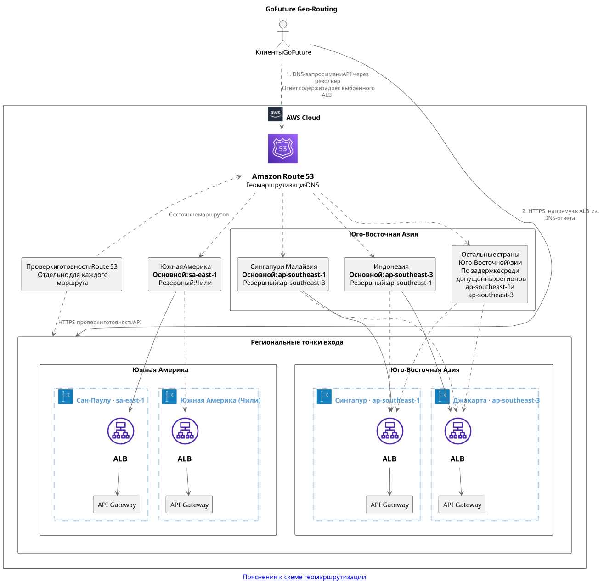
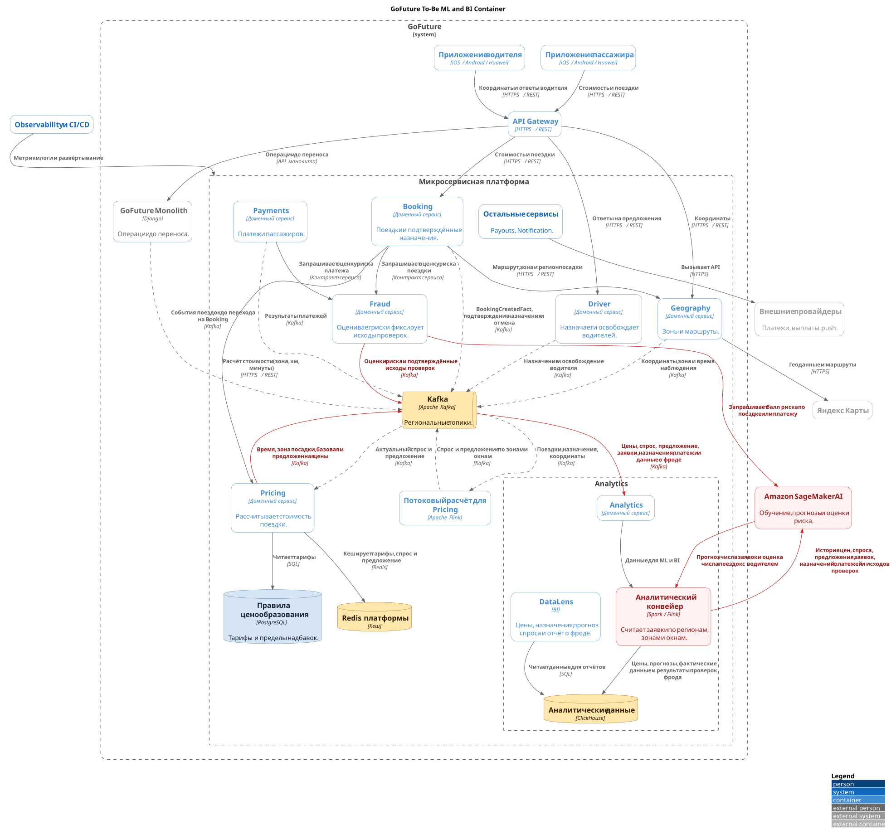
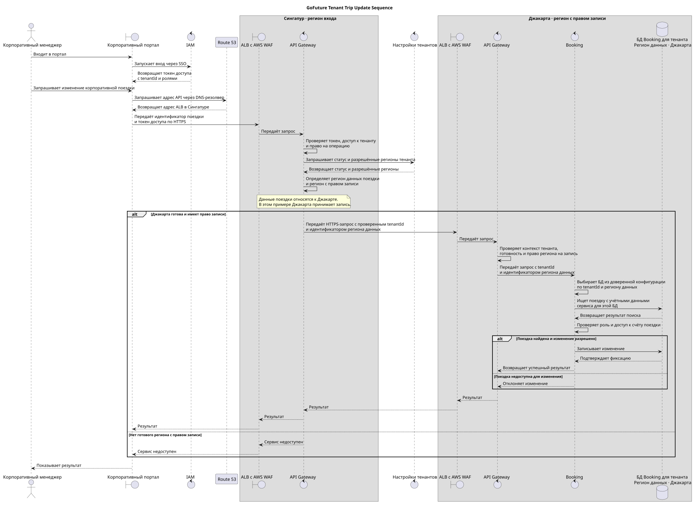

# Микросервисы: проектная работа спринта 6

- [Задание 1. Проектируем домены](#задание-1-проектируем-домены)
- [Задание 2. Проектируем Event-Driven архитектуру](#задание-2-проектируем-event-driven-архитектуру)
- [Задание 3. Обеспечиваем высокую нагрузку](#задание-3-обеспечиваем-высокую-нагрузку)
- [Задание 4. Конвейер данных для ML и BI](#задание-4-конвейер-данных-для-ml-и-bi)
- [Задание 5. Мультитенантная платформа](#задание-5-мультитенантная-платформа)

---

## Задание 1. Проектируем домены

GoFuture переходит от монолита к доменным сервисам. API Gateway сохраняет прежний API для клиентов и переключает операции на новые сервисы по мере их выделения.

- [Нефункциональные требования](Task1/01-non-functional-requirements.ru.md) задают целевые показатели нагрузки, доступности и времени отклика.
- [Диаграмма C2](Task1/diagrams/.svg/02-to-be.container.c4.svg) показывает целевые сервисы, их базы данных и связи с внешними системами. [Исходник PlantUML](Task1/diagrams/02-to-be.container.c4.puml)
- [ADR по декомпозиции монолита](Task1/02-monolith-decomposition.adr.ru.md) объясняет решения о границах сервисов, обратной совместимости и обмене сообщениями.
- [Очерёдность выделения сервисов](Task1/03-service-extraction-order.ru.md) обосновывает порядок выделения и перечисляет предварительные условия для каждого сервиса.
- [План миграции данных](Task1/04-data-migration-plan.ru.md) описывает перенос, сверку и переключение записи для каждого из девяти сервисов.

Диаграмма C2 целевой архитектуры

## Задание 2. Проектируем Event-Driven архитектуру

Событийная платформа GoFuture использует региональные топики Kafka для обмена сообщениями. Camunda координирует назначение водителя, а Flink рассчитывает показатели спроса и предложения для динамического ценообразования.

- [ADR событийной платформы](Task2/01-event-driven-platform.adr.ru.md) описывает модель событий, схему топиков Kafka, Saga назначения водителя и механизмы надёжной доставки.
- [Проект мониторинга](Task2/04-monitoring-design.ru.md) обосновывает выбор подходов, определяет метрики и указывает источники их сбора.
- [Диаграмма C2](Task2/diagrams/.svg/02-event-driven-platform.container.c4.svg) показывает целевую архитектуру и связи инструментов мониторинга с источниками метрик. [Исходник PlantUML](Task2/diagrams/02-event-driven-platform.container.c4.puml)
- [Диаграмма BPMN](Task2/diagrams/.svg/03-driver-assignment-saga.bpmn.svg) показывает шаги назначения водителя и компенсации при отмене. [Исходник BPMN](Task2/diagrams/03-driver-assignment-saga.bpmn.mmd)

Диаграммы событийной платформы и назначения водителя

## Задание 3. Обеспечиваем высокую нагрузку

Проект глобального развёртывания GoFuture рассчитан на пользователей Юго-Восточной Азии и Южной Америки. Цель проекта — доступность 99,99% и низкая задержка.

- [Обоснование выбора регионов](Task3/01-region-selection.md) описывает взаимное резервирование Сингапура и Джакарты. Чили служит резервом Сан-Паулу после открытия региона AWS и проверки поддержки нужных сервисов.
- [Схема репликации](Task3/02-replication-schema.md) показывает, как GoFuture копирует данные PostgreSQL, топики Kafka, журналы Zeebe и контрольные точки Flink в парные регионы.
- [Схема геомаршрутизации](Task3/03-geo-routing.md) показывает, как Amazon Route 53 выбирает региональную точку входа по географии, задержке и готовности маршрута.
- [Диаграмма и сценарии отказа](Task3/04-failover-scenario.md) показывают основные точки отказа на диаграмме C4 и описывают последствия, действия при отказе и критерии восстановления.
- [Стратегия комплаенса](Task3/05-compliance.md) описывает согласование трансграничной передачи данных до включения репликации и соответствующего резервного маршрута.
- [Диаграмма C2 и обоснование защиты](Task3/06-security-rationale.md) описывают AWS WAF, группы безопасности VPC и защищённый путь к API Gateway.

Диаграммы репликации, геомаршрутизации, отказоустойчивости и защиты

## Задание 4. Конвейер данных для ML и BI

Спроектирован единый конвейер данных для динамического ценообразования, прогнозирования спроса и обнаружения мошенничества. Микросервисы публикуют события в Kafka. Аналитический конвейер готовит данные для Amazon SageMaker AI и записывает фактические показатели и результаты моделей в ClickHouse. DataLens читает эти данные для отчётов.

- [Диаграмма C2](Task4/diagrams/.svg/01-to-be-ml-bi.container.c4.svg) показывает конвейер для трёх сценариев. [Исходник PlantUML](Task4/diagrams/01-to-be-ml-bi.container.c4.puml)
    - **Динамическое ценообразование.** Pricing использует текущие показатели спроса и предложения из Flink. DataLens показывает цены и сравнивает ожидаемое и фактическое число поездок с назначенным водителем.
    - **Прогнозирование спроса.** SageMaker AI прогнозирует число подтверждённых заявок по зонам посадки и временным окнам. DataLens сравнивает прогнозы с фактическим спросом.
    - **Обнаружение мошенничества.** Fraud запрашивает у SageMaker AI оценку риска поездки или платежа. Подтверждённые результаты проверок служат данными для обучения и отчётности.
- [Обеспечение качества данных](Task4/02-data-quality-assurance.ru.md) описывает для каждого сценария проверяемые данные, выбранные механизмы, предотвращаемые ошибки и место проверки в конвейере.

Диаграмма C2 конвейера данных для ML и BI

## Задание 5. Мультитенантная платформа

GoFuture подключает организации-партнёры как тенантов. При подключении платформа настраивает роли, регионы обработки данных и доступные функции. Тенанты в одном регионе используют общую инфраструктуру. Каждый тенант получает отдельные логические ресурсы и права доступа.

- [Диаграмма C2](Task5/diagrams/.svg/02-multitenant-platform.container.c4.svg) показывает вход через IAM, региональную маршрутизацию, подключение партнёра и мониторинг по тенантам и регионам.
- В разделе [«Роли, доступ к данным и изоляция»](Task5/01-roles-data-isolation.md) таблица ролей определяет операции и область доступа для каждого пользователя. Таблица изоляции описывает разграничение доступа к данным и условия восстановления.
- [Диаграмма последовательности](Task5/diagrams/.svg/SEQ-02-tenant-trip.sequence.ru.svg) показывает, как GoFuture проверяет контекст тенанта, выбирает регион записи и обращается к БД тенанта при изменении поездки.

Диаграммы мультитенантной платформы и изменения поездки

