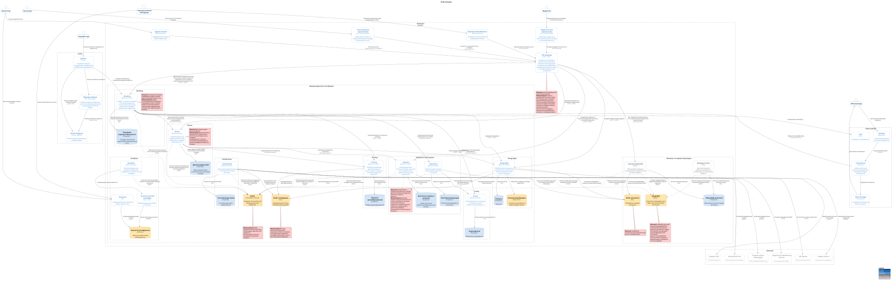

# GoFuture. Проектная работа спринта 6

## Задание 1. Проектируем домены

GoFuture переходит от монолита к доменным сервисам. На диаграмме показано, как API Gateway сохраняет прежний API для клиентов и переключает операции на новые сервисы по мере их выделения.

- [Нефункциональные требования](Task1/01-non-functional-requirements.ru.md): целевые показатели нагрузки, доступности и времени отклика.
- **Диаграмма To-Be контейнеров**: целевые сервисы, их базы данных и связи с внешними системами. Диаграмма раскрывается ниже. [Исходник PlantUML](Task1/02-to-be.container.c4.puml)

Диаграмма To-Be контейнеров

