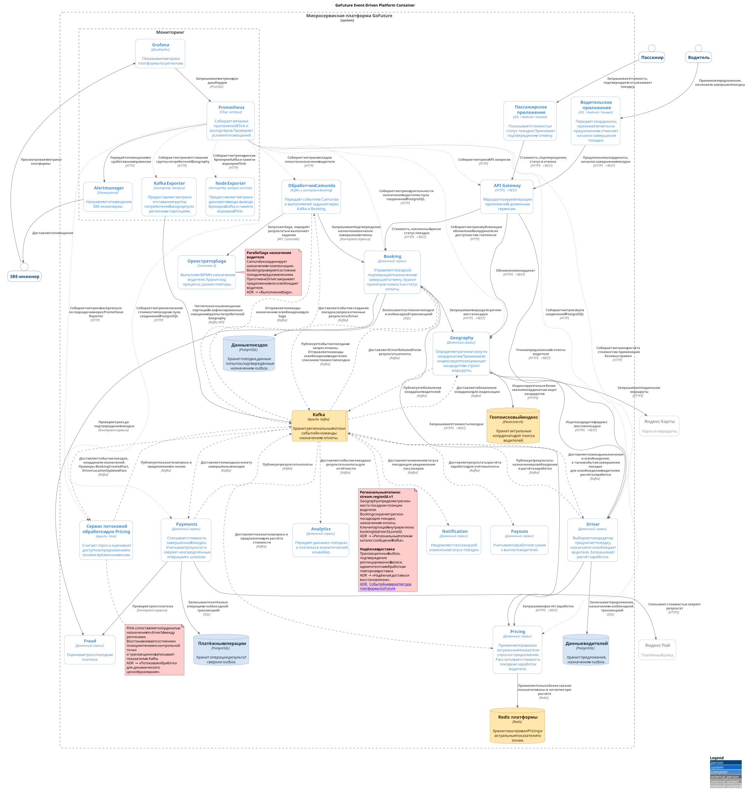

# GoFuture

## Задание 4. Конвейер данных для ML и BI

Спроектирован единый конвейер данных для динамического ценообразования, прогнозирования спроса и обнаружения мошенничества. Микросервисы публикуют события в Kafka. Аналитический конвейер готовит данные для Amazon SageMaker AI и записывает фактические показатели и результаты моделей в ClickHouse. DataLens читает эти данные для отчётов.

| Сценарий | Результат |
| --- | --- |
| Динамическое ценообразование | Pricing использует текущие показатели спроса и предложения из Flink. DataLens показывает цены и сравнивает ожидаемое и фактическое число поездок с назначенным водителем. |
| Прогнозирование спроса | SageMaker AI прогнозирует число подтверждённых заявок по зонам посадки и временным окнам. DataLens сравнивает прогнозы с фактическим спросом. |
| Обнаружение мошенничества | Fraud запрашивает у SageMaker AI оценку риска поездки или платежа. Подтверждённые результаты проверок служат данными для обучения и отчётности. |

### Артефакты

- [Диаграмма контейнеров C4 (SVG)](Task4/diagrams/.svg/01-to-be-ml-bi.container.c4.svg) · [Исходный код PlantUML](Task4/diagrams/01-to-be-ml-bi.container.c4.puml)
- Для каждого сценария указаны проверяемые данные, выбранные механизмы, предотвращаемые ошибки и место проверки в конвейере. [Обеспечение качества данных](Task4/02-data-quality-assurance.ru.md)
# MSA-GoFuture

## Задание 3. Обеспечиваем высокую нагрузку

Проект глобального развёртывания GoFuture рассчитан на пользователей Юго-Восточной Азии и Южной Америки. Цель проекта — доступность 99,99% и низкая задержка.

1. **Регионы развёртывания.** Сингапур и Джакарта резервируют друг друга. Чили служит резервом Сан-Паулу после открытия региона AWS и проверки поддержки нужных сервисов. [Обоснование выбора регионов](Task3/01-region-selection.md)
2. **Репликация.** Схема показывает, как GoFuture копирует данные PostgreSQL, топики Kafka, журналы Zeebe и контрольные точки Flink в парные регионы. [Схема репликации](Task3/02-replication-schema.md)
3. **Геомаршрутизация.** Amazon Route 53 выбирает региональную точку входа по географии, задержке и готовности маршрута. [Схема геомаршрутизации](Task3/03-geo-routing.md)
4. **Аварийное переключение.** Диаграмма C4 отмечает основные точки отказа. Таблица описывает влияние каждого сценария, действия при отказе и критерии восстановления. [Диаграмма и сценарии отказа](Task3/04-failover-scenario.md)
5. **Комплаенс.** GoFuture согласует трансграничную передачу данных до включения репликации и соответствующего резервного маршрута. [Стратегия комплаенса](Task3/05-compliance.md)
6. **Защита входящего трафика.** Обновлённая диаграмма C2 выделяет AWS WAF, группы безопасности VPC и защищённый путь к API Gateway. [Диаграмма C2 и обоснование защиты](Task3/06-security-rationale.md)
# GoFuture. Проектная работа спринта 6

## Задание 2. Проектируем Event-Driven архитектуру

Событийная платформа GoFuture использует региональные топики Kafka для обмена сообщениями. Camunda координирует назначение водителя, а Flink рассчитывает показатели спроса и предложения для динамического ценообразования.

- [ADR событийной платформы](Task2/01-event-driven-platform.adr.ru.md) описывает модель событий, схему топиков Kafka, Saga назначения водителя и механизмы надёжной доставки.
- [Проект мониторинга](Task2/04-monitoring-design.ru.md) обосновывает выбор подходов, определяет метрики и указывает источники их сбора.
- [Исходный код диаграммы C2](Task2/diagrams/02-event-driven-platform.container.c4.puml) показывает целевую архитектуру и связи инструментов мониторинга с источниками метрик.
- [Исходный код диаграммы BPMN](Task2/diagrams/03-driver-assignment-saga.bpmn.mmd) показывает шаги назначения водителя и компенсации при отмене.

GoFuture Event-Driven Platform Container

## Задание 1. Проектируем домены

GoFuture переходит от монолита к доменным сервисам. На диаграмме показано, как API Gateway сохраняет прежний API для клиентов и переключает операции на новые сервисы по мере их выделения.

- [Нефункциональные требования](Task1/01-non-functional-requirements.ru.md): целевые показатели нагрузки, доступности и времени отклика.
- **Диаграмма To-Be контейнеров**: целевые сервисы, их базы данных и связи с внешними системами. Диаграмма раскрывается ниже. [Исходник PlantUML](Task1/diagrams/02-to-be.container.c4.puml)
- [ADR по декомпозиции монолита](Task1/02-monolith-decomposition.adr.ru.md) объясняет решения о границах сервисов, обратной совместимости и обмене сообщениями.
- [Очерёдность выделения сервисов](Task1/03-service-extraction-order.ru.md) обосновывает порядок выделения и перечисляет предварительные условия для каждого сервиса.
- [План миграции данных](Task1/04-data-migration-plan.ru.md) описывает перенос, сверку и переключение записи для каждого из девяти сервисов.

Диаграмма To-Be контейнеров

