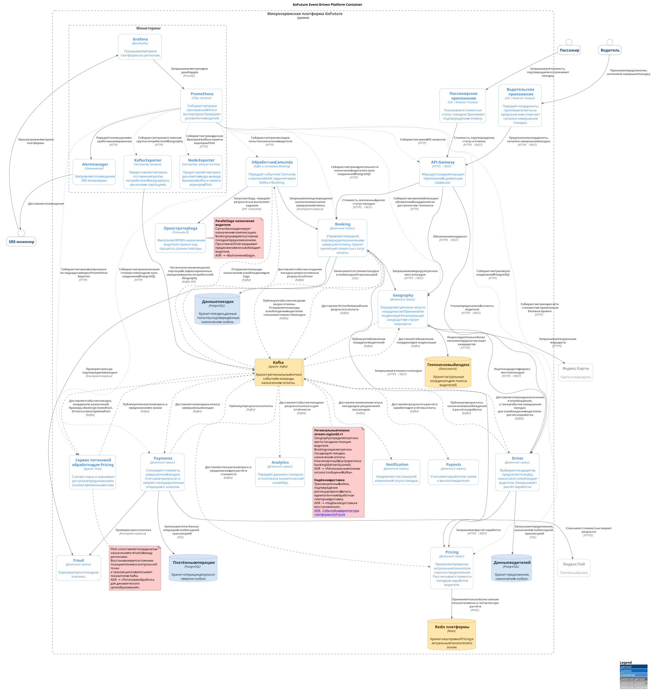
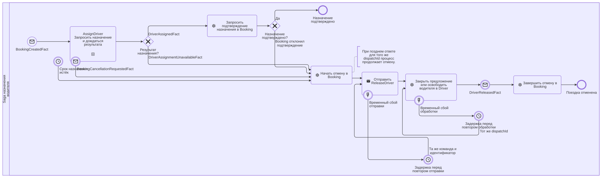

# ADR. Событийная архитектура платформы GoFuture

**Статус:** ⚠️ На рассмотрении  
**Участники:** Владелец продукта; архитектор решения  
**Дата:** 2026-11-22

<b>Содержание</b>

- [Контекст](#контекст)
- [Диаграмма контейнеров платформы](#диаграмма-контейнеров-платформы)
- [Региональные топики и каталог сообщений Kafka](#региональные-топики-и-каталог-сообщений-kafka)
  - [Каталог событий и команд](#каталог-событий-и-команд)
- [Saga назначения водителя](#saga-назначения-водителя)
  - [Реестр транзакций Saga](#реестр-транзакций-saga)
  - [Выполнение Saga](#выполнение-saga)
- [Потоковая обработка для динамического ценообразования](#потоковая-обработка-для-динамического-ценообразования)
- [Надёжная доставка и восстановление](#надёжная-доставка-и-восстановление)

## Контекст

По заданию 2 событийная платформа должна одновременно обрабатывать более 500 000 поездок.

## Диаграмма контейнеров платформы

GoFuture Event-Driven Platform Container

## Региональные топики и каталог сообщений Kafka

Имена региональных топиков Kafka имеют вид `<stream>.<regionId>.v1`. Для сообщений о поездке, назначении и оплате Booking сохраняет регион места посадки. Geography определяет регион наблюдения по координатам водителя. Geography отправляет обновление координат в топик этого региона. Ключ сообщения определяет партицию внутри топика. Число партиций зависит от нагрузки в регионе. Каждое приложение использует свою группу потребителей в регионе.

### Каталог событий и команд

`BookingCreatedFact` и `DriverLocationUpdatedFact` соответствуют примерам `BookingCreated` и `DriverLocationUpdated` из задания. Суффикс `Fact` обозначает факт предметной области. Суффикс `Event` обозначает событие уровня приложения.

| Поток и ключ партиции                     | Сообщение                          | Издатель → потребители                         | Значение                                                                                                                                          |
| ----------------------------------------- | ---------------------------------- | ---------------------------------------------- | ------------------------------------------------------------------------------------------------------------------------------------------------- |
| `booking.facts` · `bookingId`             | `BookingCreatedFact`               | Booking → обработчик Camunda, Flink, Analytics | Booking создал поездку после того, как пассажир подтвердил предложенную стоимость.                                                                |
| `booking.facts` · `bookingId`             | `BookingCancellationRequestedFact` | Booking → обработчик Camunda                   | Booking перевёл поездку в состояние «отмена в процессе» по запросу пассажира до подтверждения назначения.                                         |
| `booking.facts` · `bookingId`             | `BookingDriverConfirmedFact`       | Booking → Notification, Analytics              | Booking записал подтверждённое назначение.                                                                                                        |
| `booking.facts` · `bookingId`             | `BookingCanceledFact`              | Booking → Notification, Analytics, Flink       | Booking завершил отмену поездки.                                                                                                                  |
| `booking.facts` · `bookingId`             | `TripStartedFact`                  | Booking → Notification, Analytics              | Назначенный водитель начал поездку.                                                                                                               |
| `booking.facts` · `bookingId`             | `TripCompletedFact`                | Booking → Driver, Notification, Analytics      | Назначенный водитель завершил поездку. Driver освобождает водителя и запускает расчёт заработка.                                                  |
| `driver.dispatch.commands` · `bookingId`  | `AssignDriver`                     | обработчик Camunda → Driver                    | Начать подбор и назначение. Команда содержит `bookingId`, `dispatchId`, `regionId`, место посадки и срок назначения.                              |
| `driver.dispatch.commands` · `bookingId`  | `ReleaseDriver`                    | обработчик Camunda или Booking → Driver        | Закрыть открытое предложение или освободить водителя в указанной попытке.                                                                         |
| `driver.dispatch.facts` · `bookingId`     | `DriverAssignedFact`               | Driver → обработчик Camunda, Flink             | Водитель принял предложение, Driver зафиксировал назначение.                                                                                      |
| `driver.dispatch.facts` · `bookingId`     | `DriverAssignmentUnavailableFact`  | Driver → обработчик Camunda                    | Подбор завершился без назначения. Факт указывает, исчерпал ли Driver список кандидатов или истёк срок назначения.                                 |
| `driver.dispatch.facts` · `bookingId`     | `DriverReleasedFact`               | Driver → обработчик Camunda, Booking, Flink    | Driver подтвердил, что в попытке отсутствуют открытое предложение и активное назначение. При освобождении водителя сообщение содержит `driverId`. |
| `geography.location.facts` · `driverId`   | `DriverLocationUpdatedFact`        | Geography → Geography, Flink                   | Geography принял координаты водителя с зоной и временем наблюдения.                                                                               |
| `pricing.supply-demand.events` · `zoneId` | `SupplyDemandUpdatedEvent`         | Flink → Pricing                                | Flink рассчитал показатели спроса и предложения для зоны за временное окно.                                                                       |
| `payments.fare.commands` · `bookingId`    | `CollectFare`                      | Booking → Payments                             | Списать принятую стоимость завершённой поездки с использованием платёжного идентификатора поездки.                                                |
| `payments.fare.facts` · `bookingId`       | `FareCollectedFact`                | Payments → Booking, Analytics                  | Payments подтвердил списание стоимости поездки.                                                                                                   |
| `payments.fare.facts` · `bookingId`       | `FareCollectionDeclinedFact`       | Payments → Booking, Analytics                  | Payments зафиксировал подтверждённый отказ.                                                                                                       |
| `driver.earnings.events` · `bookingId`    | `DriverEarningsCalculatedEvent`    | Driver → Payouts                               | Driver получил от Pricing расчёт заработка за завершённую поездку.                                                                                |

## Saga назначения водителя

Результат подбора водителя может поступить после ответа Booking на запрос о создании поездки. Во время подбора пассажир может запросить отмену. Для назначения допустима согласованность в конечном счёте, поэтому выбираем Parallel Saga. Оркестратор обрабатывает результат подбора, отмену и истечение срока назначения. Booking сохраняет состояние «отмена в процессе» до получения `DriverReleasedFact`.

Camunda 8 выполняет процесс назначения водителя по модели BPMN. Оркестратор продолжает процесс после перезапуска и управляет таймерами, повторами и инцидентами. Команда развёртывает Camunda отдельно от Booking и Driver. При реализации машины состояний в Booking команда сама пишет и сопровождает код переходов, таймеров и восстановления. Camunda также подходит для возможных Saga авторизации оплаты пассажира и выплаты заработка водителю. [Таймеры](https://docs.camunda.io/docs/8.9/components/modeler/bpmn/timer-events/) · [Повторы заданий](https://docs.camunda.io/docs/8.9/apis-tools/zeebe-api/gateway-service/) · [Инциденты](https://docs.camunda.io/docs/8.8/components/concepts/incidents/)

### Реестр транзакций Saga

| №     | Транзакция                            | Описание                                                                                                                                         | Тип                                | Компенсация                            |
| ----- | ------------------------------------- | ------------------------------------------------------------------------------------------------------------------------------------------------ | ---------------------------------- | -------------------------------------- |
| 1     | `CREATE_BOOKING_AND_DISPATCH_ATTEMPT` | Booking в одной локальной транзакции сохраняет поездку и данные попытки и записывает `BookingCreatedFact` в outbox.                              | Компенсируемая                     | 2.2.2. `COMPLETE_BOOKING_CANCELLATION` |
| 2     | `ASSIGN_DRIVER`                       | Driver в одной транзакции сохраняет назначение для этой попытки и записывает `DriverAssignedFact` в outbox.                                     | Компенсируемая                     | 2.2.1. `RELEASE_DRIVER`                |
| 2.1   | `CONFIRM_DRIVER_ASSIGNMENT`           | Booking сохраняет подтверждённое назначение и записывает `BookingDriverConfirmedFact` в outbox.                                                 | Завершающая, успешный исход        | —                                      |
| 2.2   | `START_BOOKING_CANCELLATION`          | Booking фиксирует состояние «отмена в процессе». После подтверждения этой операции обработчик Camunda отправляет `ReleaseDriver`.                | Повторяемая                        | —                                      |
| 2.2.1 | `RELEASE_DRIVER`                      | Driver закрывает попытку по `dispatchId` и записывает `DriverReleasedFact` в outbox. Если попытка уже закрыта, Driver подтверждает тот же результат. | Повторяемая, компенсация           | —                                      |
| 2.2.2 | `COMPLETE_BOOKING_CANCELLATION`       | После `DriverReleasedFact` Booking переводит поездку в состояние «поездка отменена» и записывает `BookingCanceledFact` в outbox.                  | Повторяемая, завершает компенсацию | —                                      |

### Выполнение Saga

`BookingCreatedFact` запускает Saga по `dispatchId`. Обработчик Camunda отправляет `AssignDriver`. При `DriverAssignedFact` Camunda запрашивает подтверждение в Booking. Booking проверяет состояние поездки и срок назначения и публикует `BookingDriverConfirmedFact` после записи назначения.

При отмене до подтверждения Booking записывает `BookingCancellationRequestedFact` и переводит поездку в состояние «отмена в процессе» одной транзакцией. В этом состоянии Booking отклоняет подтверждение назначения для этой попытки. Camunda координирует компенсацию при отмене, истечении срока, получении `DriverAssignmentUnavailableFact` или отказе Booking подтвердить назначение. Обработчик отправляет `ReleaseDriver` после подтверждения начала отмены в Booking. Booking завершает отмену после `DriverReleasedFact` и публикует `BookingCanceledFact`.

Saga назначения водителя

## Потоковая обработка для динамического ценообразования

Задание Apache Flink рассчитывает показатели спроса и предложения для Pricing в реальном времени. Flink оценивает спрос по созданию и отмене поездок. Для оценки предложения Flink сопоставляет координаты и назначения по `driverId` между регионами. Flink учитывает водителя без активного назначения по его последней позиции, пока координаты актуальны. При получении `TripCompletedFact` Driver закрывает назначение и в той же транзакции записывает `DriverReleasedFact` в outbox. По этому факту Flink снимает признак активного назначения для завершённой попытки.

Flink агрегирует данные по региону, зоне и временному окну и публикует `SupplyDemandUpdatedEvent`. Pricing использует актуальные показатели для расчёта стоимости, сохраняет их в Redis и восстанавливает кеш из компактируемого топика. При отсутствии актуального показателя Pricing применяет базовые правила.

## Надёжная доставка и восстановление

- Booking, Driver и Payments записывают сообщения в outbox одной транзакцией с изменениями данных. Публикатор сохраняет порядок сообщений агрегата и повторяет отправку с исходным идентификатором до подтверждения Kafka.
- Kafka использует коэффициент репликации 3 и `min.insync.replicas=2`. Производители используют `acks=all` и идемпотентную отправку. Потребитель записывает идентификатор сообщения вместе с изменениями и фиксирует смещение после успешной обработки.
- Обработчик Camunda завершает задание после подтверждения записи команды в Kafka. После того как Camunda принимает входящий факт, обработчик фиксирует смещение этого сообщения. При повторе обработчик сохраняет идентификатор сообщения и `dispatchId`. Booking и Driver обрабатывают повторы идемпотентно.
- При временном сбое отправитель или потребитель повторяет операцию с увеличением задержки. При устойчивом сбое команды назначения или оплаты потребитель сохраняет порядок партиции и продолжает чтение после исправления и повтора.
- Geography подтверждает приём координат после записи в Kafka. Geography восстанавливает индекс Elasticsearch из событий Kafka или из снимка. При восстановлении из снимка Geography продолжает чтение из Kafka с позиции этого снимка.
- Flink восстанавливает состояние и позиции чтения из контрольных точек. Flink транзакционно записывает результаты в Kafka. Pricing читает результаты после фиксации транзакции Kafka.
- Payments хранит одну операцию на поездку. Перед повторным списанием Payments сверяет результат операции с неизвестным исходом. Payouts учитывает заработок один раз на поездку.
