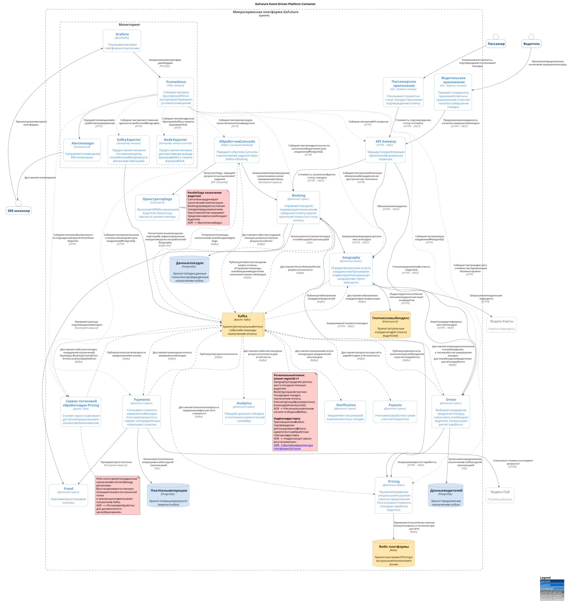

# Проект мониторинга событийной платформы

<b>Содержание</b>

- [Контекст системы](#контекст-системы)
- [Выбор и обоснование подходов к мониторингу](#выбор-и-обоснование-подходов-к-мониторингу)
- [Метрики](#метрики)
  - [RED](#red)
  - [USE](#use)
  - [Дополнительные метрики обработки событий](#дополнительные-метрики-обработки-событий)
- [Инструменты мониторинга и диаграмма C2](#инструменты-мониторинга-и-диаграмма-c2)
  - [Выбор и обоснование инструментов мониторинга](#выбор-и-обоснование-инструментов-мониторинга)
  - [Источники и сбор метрик](#источники-и-сбор-метрик)

---

## Контекст системы

GoFuture должна одновременно обрабатывать более 500 000 поездок и обновлять цены в реальном времени. Во время пика нагрузки в регионе платформа должна отвечать на запросы и обрабатывать события. От этих событий зависят назначение водителя и расчёт стоимости. Booking может вовремя принять запрос, а пассажир продолжит ждать водителя. Мониторинг охватывает запрос к API и результат операции.

## Выбор и обоснование подходов к мониторингу

- **RED.** Частота запросов, ошибки и длительность обработки показывают, успевает ли API успешно обработать запросы при росте нагрузки. Исходы попыток назначения водителя и время до подтверждения показывают, что происходит после того, как Booking принимает запрос.
- **USE.** Если запросы обрабатываются медленнее или события накапливаются, метрики ресурсов помогают определить, что ограничивает пропускную способность. Если пропускная способность Kafka снижается, занятость дисков брокера, глубина очереди и ошибки ввода-вывода помогают выявить узкое место в дисковой подсистеме.
- **Дополнительные метрики обработки событий.** На пике нагрузки частота событий показывает, сколько обновлений координат поступает в Kafka за секунду в регионе. Рост отставания группы потребителей Geography показывает, что сервис не успевает обрабатывать обновления. Метрика актуальности координат в Geography показывает, становятся ли принятые обновления доступны для поиска вовремя. Driver использует актуальные координаты для поиска кандидатов рядом с местом посадки.

## Метрики

### RED

<table style="font-size: 0.85rem;">
  <thead style="vertical-align: top;">
    <tr>
      <th valign="top" scope="col">Сигнал</th>
      <th valign="top" scope="col">Метрика</th>
      <th valign="top" scope="col">Измерение</th>
    </tr>
  </thead>
  <tbody style="vertical-align: top;">
    <tr>
      <th valign="top" colspan="3" scope="rowgroup" style="text-align: left;">
        Запросы к API
        
В каждом регионе рассчитывайте метрики отдельно по операциям. Учитывайте запросы на расчёт стоимости, создание поездки и получение её статуса.

      </th>
    </tr>
    <tr>
      <td valign="top">Частота</td>
      <td valign="top">RPS</td>
      <td valign="top">Считайте все входящие запросы, включая запросы, которые завершились ошибкой или по тайм-ауту.</td>
    </tr>
    <tr>
      <td valign="top">Ошибки</td>
      <td valign="top">Доля запросов с ошибкой (%)</td>
      <td valign="top">Доля запросов, которые завершились ошибкой сервера или по тайм-ауту.</td>
    </tr>
    <tr>
      <td valign="top">Длительность</td>
      <td valign="top">Гистограмма времени ответа API</td>
      <td valign="top">Распределите запросы по интервалам длительности.</td>
    </tr>
    <tr>
      <td valign="top">Длительность</td>
      <td valign="top">Доля успешных запросов за 500 мс и за 1 с (%)</td>
      <td valign="top">Для каждого порога разделите число запросов, которые успешно завершились в пределах порога, на общее число запросов. <a href="../Task1/01-non-functional-requirements.ru.md">NFR-16</a></td>
    </tr>
  </tbody>
  <tbody style="vertical-align: top;">
    <tr>
      <th valign="top" colspan="3" scope="rowgroup" style="text-align: left;">
        Назначение водителя, расчёт стоимости и списание стоимости поездки
      </th>
    </tr>
    <tr>
      <td valign="top">Частота</td>
      <td valign="top">Попытки назначения водителя по исходам (число и частота)</td>
      <td valign="top">После завершения попытки учитывайте её исход. Booking подтверждает назначение, Driver исчерпывает список кандидатов, срок назначения истекает или пассажир отменяет поездку до подтверждения. Если Booking отклоняет подтверждение из-за отмены поездки или истечения срока назначения, учитывайте эту причину как исход. Для остальных отказов используйте исход «Booking отклонил подтверждение». Для каждого исхода укажите число попыток за отчётный период и частоту в попытках за секунду.</td>
    </tr>
    <tr>
      <td valign="top">Длительность</td>
      <td valign="top">Длительность назначения водителя</td>
      <td valign="top">Время от создания поездки до подтверждения назначения.</td>
    </tr>
    <tr>
      <td valign="top">Частота</td>
      <td valign="top">Доля расчётов стоимости по базовым правилам (%)</td>
      <td valign="top">Доля расчётов, в которых Pricing применяет базовые правила из-за отсутствия актуальных показателей спроса и предложения.</td>
    </tr>
    <tr>
      <td valign="top">Частота</td>
      <td valign="top">Попытки списания стоимости поездки по исходам (число и частота)</td>
      <td valign="top">Для каждого подтверждённого исхода укажите число попыток за отчётный период и частоту в попытках за секунду. Отдельно учитывайте успешные списания и отказы в списании.</td>
    </tr>
    <tr>
      <td valign="top">Ожидание</td>
      <td valign="top">Попытки списания в ожидании сверки</td>
      <td valign="top">Считайте попытки, которые сейчас ожидают сверки. Исключайте попытку из подсчёта, когда Payments подтверждает её результат.</td>
    </tr>
    <tr>
      <td valign="top">Длительность</td>
      <td valign="top">Длительность списания стоимости поездки</td>
      <td valign="top">Время от начала списания до подтверждения результата.</td>
    </tr>
  </tbody>
</table>

### USE

Измеряйте каждый ресурс отдельно в каждом регионе.

<table style="font-size: 0.85rem;">
  <thead style="vertical-align: top;">
    <tr>
      <th valign="top" scope="col">Сигнал</th>
      <th valign="top" scope="col">Метрика</th>
      <th valign="top" scope="col">Измерение</th>
    </tr>
  </thead>
  <tbody style="vertical-align: top;">
    <tr>
      <th valign="top" colspan="3" scope="rowgroup" style="text-align: left;">Дисковый ввод-вывод брокеров Kafka</th>
    </tr>
    <tr>
      <td valign="top">Использование</td>
      <td valign="top">Занятость диска (%)</td>
      <td valign="top">Доля времени, когда диск брокера обслуживает операции ввода-вывода.</td>
    </tr>
    <tr>
      <td valign="top">Глубина очереди</td>
      <td valign="top">Запросы дискового ввода-вывода в очереди</td>
      <td valign="top">Считайте запросы ввода-вывода, которые ещё находятся в очереди.</td>
    </tr>
    <tr>
      <td valign="top">Ошибки ввода-вывода</td>
      <td valign="top">Число ошибок чтения и записи на диске</td>
      <td valign="top">Считайте операции чтения и записи, которые завершились ошибкой.</td>
    </tr>
  </tbody>
  <tbody style="vertical-align: top;">
    <tr>
      <th valign="top" colspan="3" scope="rowgroup" style="text-align: left;">Память воркеров Flink</th>
    </tr>
    <tr>
      <td valign="top">Использование</td>
      <td valign="top">Использование памяти воркера (%)</td>
      <td valign="top">Разделите объём памяти, которую использует воркер, на его лимит памяти.</td>
    </tr>
    <tr>
      <td valign="top">Дефицит памяти</td>
      <td valign="top">Время задержек из-за дефицита памяти</td>
      <td valign="top">Измеряйте, как долго воркер приостанавливает работу из-за дефицита памяти.</td>
    </tr>
    <tr>
      <td valign="top">Завершения из-за исчерпания памяти</td>
      <td valign="top">Число завершений работы воркера</td>
      <td valign="top">Считайте завершения работы воркера из-за исчерпания памяти.</td>
    </tr>
  </tbody>
  <tbody style="vertical-align: top;">
    <tr>
      <th valign="top" colspan="3" scope="rowgroup" style="text-align: left;">Задание Flink для Pricing</th>
    </tr>
    <tr>
      <td valign="top">Backpressure</td>
      <td valign="top">Доля времени ожидания передачи записей (%)</td>
      <td valign="top">Для каждой подзадачи Flink измеряйте долю времени, когда она ждёт, пока следующий этап сможет принять записи. Если подзадача выполняет цепочку операторов, метрика охватывает всю цепочку.</td>
    </tr>
  </tbody>
  <tbody style="vertical-align: top;">
    <tr>
      <th valign="top" colspan="3" scope="rowgroup" style="text-align: left;">
        Пулы соединений PostgreSQL
        
Измеряйте пулы соединений Booking, Driver и Payments отдельно.

      </th>
    </tr>
    <tr>
      <td valign="top">Использование</td>
      <td valign="top">Доля занятых соединений в пуле (%)</td>
      <td valign="top">Разделите число соединений, которые обслуживают операции, на заданную ёмкость пула.</td>
    </tr>
    <tr>
      <td valign="top">Глубина очереди</td>
      <td valign="top">Операции в ожидании соединения</td>
      <td valign="top">Считайте операции, которые ждут соединения.</td>
    </tr>
    <tr>
      <td valign="top">Ошибки получения соединения</td>
      <td valign="top">Число неудачных попыток получить соединение</td>
      <td valign="top">Считайте попытки получить соединение, которые завершились ошибкой или по тайм-ауту.</td>
    </tr>
  </tbody>
</table>

### Дополнительные метрики обработки событий

<table style="font-size: 0.85rem;">
  <thead style="vertical-align: top;">
    <tr>
      <th valign="top" scope="col">Метрика</th>
      <th valign="top" scope="col">Измерение</th>
    </tr>
  </thead>
  <tbody style="vertical-align: top;">
    <tr>
      <td valign="top">Частота событий обновления координат</td>
      <td valign="top">Число событий <code>DriverLocationUpdatedFact</code>, которые Geography публикует в Kafka за секунду в каждом регионе.</td>
    </tr>
    <tr>
      <td valign="top">Отставание группы потребителей Geography</td>
      <td valign="top">Измеряйте отставание по регионам и партициям для группы потребителей Kafka, которая индексирует обновления координат.</td>
    </tr>
    <tr>
      <td valign="top">Актуальность координат в Geography</td>
      <td valign="top">Измеряйте время от приёма обновления координат в Geography до момента, когда его можно найти в Elasticsearch. Не менее 99% принятых обновлений должны стать доступны для поиска в течение пяти секунд. Считайте нарушением срока каждое обновление, которое через пять секунд после приёма ещё недоступно для поиска. Это правило охватывает и обновления, которые так и не становятся доступны для поиска. <a href="../Task1/01-non-functional-requirements.ru.md">NFR-16</a></td>
    </tr>
  </tbody>
</table>

## Инструменты мониторинга и диаграмма C2

### Выбор и обоснование инструментов мониторинга

GoFuture сохраняет набор инструментов мониторинга, который команда уже использует. Prometheus собирает метрики и проверяет условия оповещений. При срабатывании правила Prometheus передаёт оповещение в Alertmanager. Alertmanager направляет его SRE-инженерам. Grafana получает данные из Prometheus. По этим данным SRE-инженеры сравнивают по регионам производительность обработки запросов, насыщение ресурсов и отставание в обработке событий.

### Источники и сбор метрик

Prometheus собирает метрики через HTTP-эндпоинты, которые предоставляют источники в таблице.

<table style="font-size: 0.85rem;">
  <thead style="vertical-align: top;">
    <tr>
      <th valign="top" scope="col">Группа метрик или метрика</th>
      <th valign="top" scope="col">Источник и способ сбора</th>
    </tr>
  </thead>
  <tbody style="vertical-align: top;">
    <tr>
      <td valign="top"><a href="#red">RED</a> → Запросы к API</td>
      <td valign="top">API Gateway регистрирует исход и длительность каждого запроса. Он предоставляет метрики запросов по операциям и регионам.</td>
    </tr>
    <tr>
      <td valign="top"><a href="#red">RED</a> → Попытки назначения водителя по исходам и длительность назначения водителя</td>
      <td valign="top">Обработчик Camunda предоставляет число завершённых попыток назначения по исходам. Booking рассчитывает длительность назначения по собственным меткам времени и предоставляет эту метрику.</td>
    </tr>
    <tr>
      <td valign="top"><a href="#red">RED</a> → Доля расчётов стоимости по базовым правилам</td>
      <td valign="top">Pricing предоставляет общее число расчётов стоимости и число расчётов по базовым правилам.</td>
    </tr>
    <tr>
      <td valign="top"><a href="#red">RED</a> → Списание стоимости поездки (исходы, ожидание сверки и длительность)</td>
      <td valign="top">Payments предоставляет число попыток по каждому подтверждённому исходу и текущее число попыток в ожидании сверки. Payments также предоставляет длительность попыток с подтверждённым результатом.</td>
    </tr>
    <tr>
      <td valign="top"><a href="#use">USE</a> → Пулы соединений PostgreSQL</td>
      <td valign="top">Booking, Driver и Payments предоставляют метрики своих пулов соединений через эндпоинты для сбора метрик.</td>
    </tr>
    <tr>
      <td valign="top"><a href="#use">USE</a> → Дисковый ввод-вывод брокеров Kafka</td>
      <td valign="top">Node Exporter предоставляет метрику занятости диска хоста брокера. Сборщик блочного ввода-вывода на хосте передаёт метрики через модуль textfile в Node Exporter. Эти метрики показывают число запросов в очереди и число ошибок чтения и записи.</td>
    </tr>
    <tr>
      <td valign="top"><a href="#use">USE</a> → Память воркеров Flink</td>
      <td valign="top">Сборщик на хосте читает метрики памяти из cgroup воркера в Linux. Он получает объём используемой памяти, лимит памяти и время задержек из-за её дефицита. Сборщик считает завершения работы из-за исчерпания памяти по событиям жизненного цикла воркера. Он передаёт метрики через модуль textfile в Node Exporter.</td>
    </tr>
    <tr>
      <td valign="top"><a href="#use">USE</a> → Задание Flink для Pricing</td>
      <td valign="top">Flink предоставляет метрики backpressure по подзадачам через Prometheus Reporter.</td>
    </tr>
    <tr>
      <td valign="top"><a href="#дополнительные-метрики-обработки-событий">Дополнительные метрики обработки событий</a> → Отставание группы потребителей Geography</td>
      <td valign="top">Kafka Exporter читает конечные смещения партиций Kafka и смещения, которые зафиксировала группа потребителей Geography. Он предоставляет метрики отставания по регионам и партициям через эндпоинт для сбора метрик.</td>
    </tr>
    <tr>
      <td valign="top"><a href="#дополнительные-метрики-обработки-событий">Дополнительные метрики обработки событий</a> → Частота событий обновления координат и актуальность координат в Geography</td>
      <td valign="top">Geography считает публикации <code>DriverLocationUpdatedFact</code> по регионам после подтверждения от Kafka. Сервис также отслеживает, стало ли каждое принятое обновление доступно для поиска в Elasticsearch и когда это произошло. Geography предоставляет обе метрики через эндпоинт для сбора метрик.</td>
    </tr>
  </tbody>
</table>

Для сбора метрик на хостах нужны Linux и доступ к cgroup и данным о жизненном цикле воркера.

GoFuture Event-Driven Platform Container

[Исходный код диаграммы C2 задания 2](diagrams/02-event-driven-platform.container.c4.puml)

