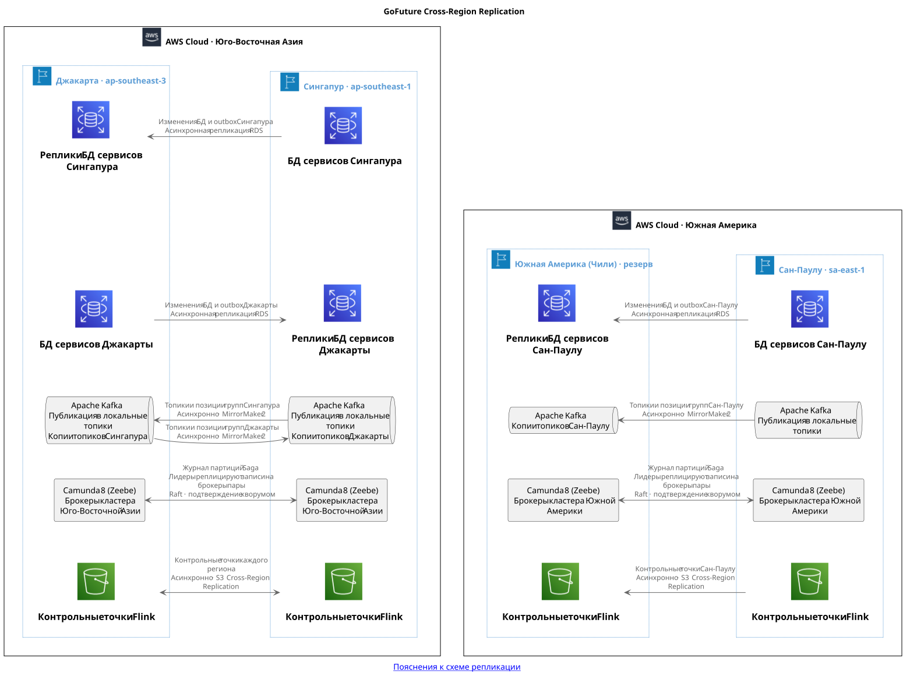

# Схема репликации GoFuture

GoFuture хранит копии данных и состояния обработки в парных регионах AWS для восстановления при отказе региона. [Выбор регионов](01-region-selection.md)

GoFuture Cross-Region Replication

## Данные сервисов и события

Сервисы, которые используют PostgreSQL, хранят данные в отдельных базах. Запись в каждую базу принимает один основной экземпляр. В Сингапуре и Джакарте сервисы записывают данные в свои базы. Поэтому встречные потоки на схеме передают изменения разных баз. Если сервис сохраняет изменение данных вместе с записью outbox, реплика сохраняет оба результата транзакции. [ADR событийной платформы](../Task2/01-event-driven-platform.adr.ru.md#надёжная-доставка-и-восстановление)

Сервисы публикуют события и команды в локальные топики Kafka с именами вида `<stream>.<regionId>.v1`. После переключения на копию топика потребителю нужна позиция, с которой он продолжит чтение. MirrorMaker 2 передаёт сведения о соответствии смещений групп потребителей в исходном топике и его копии. [ADR событийной платформы](../Task2/01-event-driven-platform.adr.ru.md#региональные-топики-и-каталог-сообщений-kafka) · [Документация Apache Kafka](https://kafka.apache.org/42/operations/geo-replication-cross-cluster-data-mirroring/)

## Состояние обработки

Zeebe хранит состояние Saga назначения водителя в журнале партиции. Лидер партиции принимает запись, а брокеры двух регионов образуют один кластер Camunda 8 и реплицируют журнал. Кластер подтверждает запись, когда её сохраняет кворум брокеров. Поэтому после отказа региона возможность продолжить обработку зависит от кворума. [Документация Camunda](https://docs.camunda.io/docs/self-managed/concepts/multi-region/dual-region/)

Для восстановления Flink в резервном регионе GoFuture должен сопоставить позиции чтения из контрольной точки со смещениями в копиях топиков Kafka. Способ сопоставления пока не выбран. Пока актуальные показатели спроса и предложения недоступны, Pricing применяет базовые правила расчёта стоимости.

Geography восстанавливает индекс Elasticsearch из событий обновления координат в Kafka. Pricing загружает показатели в Redis из компактируемого топика Kafka. [ADR событийной платформы](../Task2/01-event-driven-platform.adr.ru.md#надёжная-доставка-и-восстановление)

## Условия развёртывания

GoFuture включает поток репликации, если правила размещения данных разрешают передачу и хранение данных в паре регионов. Для развёртывания в Чили GoFuture проверяет общую доступность региона и поддержку выбранных сервисов AWS. [Выбор регионов](01-region-selection.md)
