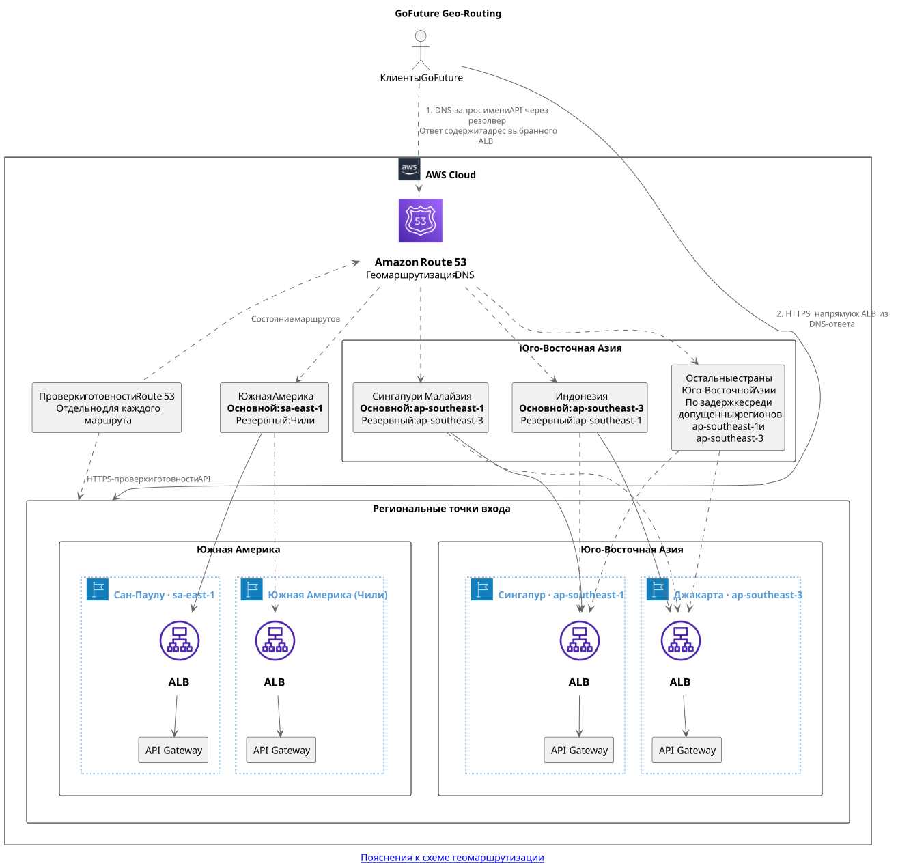

# Схема геомаршрутизации GoFuture

Amazon Route 53 применяет географическое правило к DNS-запросу общего имени API и возвращает адрес регионального ALB. Клиент подключается к этому ALB по HTTPS. [Схема геомаршрутизации](diagrams/03-geo-routing.aws.puml) · [Выбор регионов](01-region-selection.md)

GoFuture Geo-Routing

## Готовность маршрута

GoFuture проверяет готовность каждого маршрута отдельно. GoFuture проверяет доступность API, готовность данных и право региона обрабатывать эти данные. Регион может обслуживать местных пользователей, пока он готовит данные для приёма запросов из парного региона. [Схема репликации](02-replication-schema.md)

Route 53 выбирает региональную точку входа. API Gateway определяет регион данных для операции. Для записи шлюз выбирает обработчик в регионе, у которого сейчас есть право записи этих данных. Если регион ещё не готов выполнить операцию, API Gateway отклоняет запрос. [Передача права записи при отказе](04-failover-scenario.md#точки-отказа)

## Переключение DNS

Если обе DNS-записи в паре failover имеют статус `unhealthy`, Route 53 возвращает основную запись. После переключения DNS резолвер или клиент может использовать прежний адрес из DNS-кеша. В обоих случаях клиент может отправить запрос в регион, который ещё не готов выполнить операцию. API Gateway проверяет готовность региона для каждой операции, в том числе после переключения DNS. [Правила выбора записей Route 53](https://docs.aws.amazon.com/Route53/latest/DeveloperGuide/health-checks-how-route-53-chooses-records.html) · [Доступность и время восстановления](04-failover-scenario.md#доступность)
