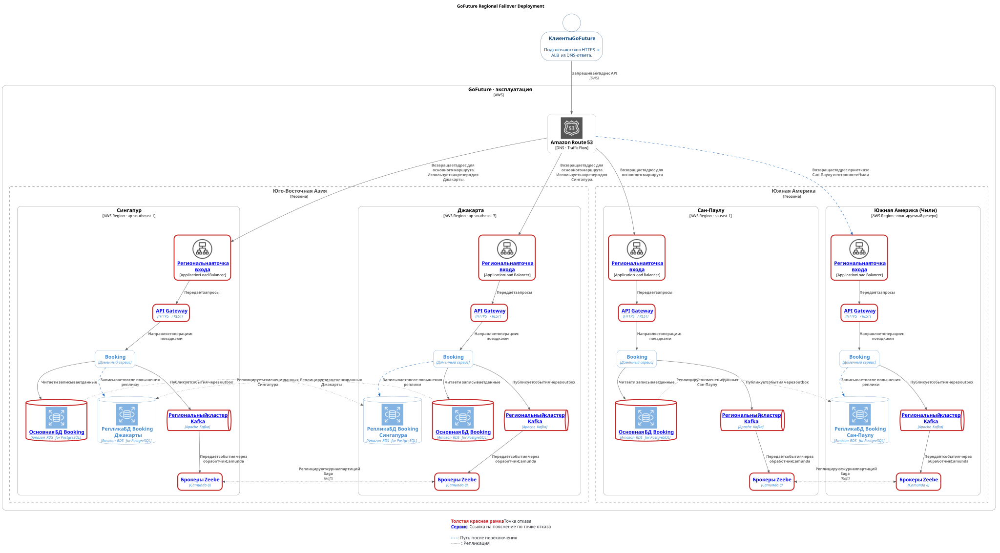

# Аварийное переключение GoFuture

<b>Содержание</b>

- [Сценарии отказа](#сценарии-отказа)
- [Точки отказа](#точки-отказа)
- [Доступность](#доступность)

---

GoFuture переключает трафик и обработку в пределах пары регионов. Сингапур и Джакарта служат резервом друг для друга. Чили служит резервом Сан-Паулу после открытия региона и подтверждения поддержки требуемых сервисов.

GoFuture Regional Failover Deployment

## Сценарии отказа

<table style="font-size: 0.85rem;">
  <thead>
    <tr>
      <th valign="top" scope="col" style="vertical-align: top;">Сценарий</th>
      <th valign="top" scope="col" style="vertical-align: top;">Признак и влияние</th>
      <th valign="top" scope="col" style="vertical-align: top;">Действие</th>
      <th valign="top" scope="col" style="vertical-align: top;">Критерий восстановления</th>
    </tr>
  </thead>
  <tbody>
    <tr>
      <td valign="top" style="vertical-align: top;">Не отвечает региональный API</td>
      <td valign="top" style="vertical-align: top;">HTTPS-проверки маршрута завершаются ошибкой или по тайм-ауту. Пользователи не могут обратиться к API через этот регион.</td>
      <td valign="top" style="vertical-align: top;">Route 53 возвращает адрес парного региона, если тот готов принять трафик и обработать запросы.</td>
      <td valign="top" style="vertical-align: top;">Клиенты получают новый DNS-ответ и выполняют затронутые операции через резервную точку входа.</td>
    </tr>
    <tr>
      <td valign="top" style="vertical-align: top;">Основная БД Booking перестала принимать запись</td>
      <td valign="top" style="vertical-align: top;">Booking получает ошибки записи. Пользователи не могут создавать заказы поездки, хотя API может отвечать.</td>
      <td valign="top" style="vertical-align: top;">GoFuture повышает реплику в парном регионе и передаёт ей право записи. Booking переключается на новую основную БД.</td>
      <td valign="top" style="vertical-align: top;">Booking записывает заказ в новую основную БД, а API возвращает клиенту успешный ответ.</td>
    </tr>
    <tr>
      <td valign="top" style="vertical-align: top;">Региональный кластер Kafka недоступен</td>
      <td valign="top" style="vertical-align: top;">Производители не получают подтверждения от Kafka. Потребители перестают получать события и команды. Пассажиры могут дольше ждать назначения водителя.</td>
      <td valign="top" style="vertical-align: top;">Потребители переходят на копии топиков в парном регионе. Публикаторы возобновляют отправку из доступного outbox.</td>
      <td valign="top" style="vertical-align: top;">Kafka принимает события. Потребители обрабатывают новые сообщения и сообщения, которые накопились за время сбоя. Потребители применяют каждое изменение один раз.</td>
    </tr>
    <tr>
      <td valign="top" style="vertical-align: top;">Партиции Zeebe потеряли кворум</td>
      <td valign="top" style="vertical-align: top;">Zeebe перестаёт подтверждать записи в затронутых партициях. Назначение водителей в этих Saga приостанавливается.</td>
      <td valign="top" style="vertical-align: top;">При кратком сбое Zeebe ждёт восстановления кворума. При подтверждённой потере региона оператор восстанавливает кворум в парном регионе.</td>
      <td valign="top" style="vertical-align: top;">Партиции снова принимают записи, и затронутые Saga продолжают обработку.</td>
    </tr>
    <tr>
      <td valign="top" style="vertical-align: top;">Сбой AWS в Сан-Паулу затронул API и региональные зависимости</td>
      <td valign="top" style="vertical-align: top;">Пользователи получают тайм-ауты при создании заказа поездки. Проверки показывают, какие из зависимостей Сан-Паулу недоступны.</td>
      <td valign="top" style="vertical-align: top;">GoFuture восстанавливает запись заказов и обработку событий в Чили. Route 53 возвращает адрес Чили после проверки готовности маршрута.</td>
      <td valign="top" style="vertical-align: top;">Пользователь создаёт заказ через Чили. Booking сохраняет заказ и публикует событие, после чего обработка назначения водителя продолжается.</td>
    </tr>
  </tbody>
</table>

## Точки отказа

> [!TIP]
> Красные рамки на диаграмме отмечают элементы, отказ которых описывает эта таблица.

<table style="font-size: 0.85rem;">
  <thead>
    <tr>
      <th valign="top" scope="col" style="vertical-align: top;">Точка отказа</th>
      <th valign="top" scope="col" style="vertical-align: top;">Отказ и восстановление</th>
    </tr>
  </thead>
  <tbody>
    <tr>
      <td valign="top" style="vertical-align: top;"><strong>Региональная точка входа</strong> (ALB и API Gateway)</td>
      <td valign="top" style="vertical-align: top;">
        
<strong>Отказ:</strong> Отказ ALB или недоступность API Gateway прерывает путь от клиента к сервисам.

        
<strong>Восстановление:</strong> Route 53 использует результаты HTTPS-проверок каждого маршрута. Резервный маршрут готов, когда API доступен, регион может принять нагрузку, данные готовы к использованию и правила разрешают их обработку. После переключения DNS клиенты могут продолжать обращаться к прежнему ALB по адресу из кеша. API Gateway проверяет готовность региона для каждой операции и отклоняет запросы, которые регион ещё не может выполнить. <a href="03-geo-routing.md">Схема геомаршрутизации</a>

      </td>
    </tr>
    <tr>
      <td valign="top" style="vertical-align: top;"><strong>Основная БД Booking</strong> (Amazon RDS for PostgreSQL)</td>
      <td valign="top" style="vertical-align: top;">
        
<strong>Отказ:</strong> При потере основной БД Booking перестаёт записывать изменения поездок и сообщения outbox.

        
<strong>Восстановление:</strong> По отставанию реплики GoFuture оценивает, какие последние изменения могли остаться в прежнем регионе. GoFuture блокирует запись в прежнюю основную БД, повышает реплику и передаёт ей право записи. После этого Booking направляет записи в новую основную БД. <a href="02-replication-schema.md">Схема репликации</a> · <a href="https://docs.aws.amazon.com/AmazonRDS/latest/UserGuide/USER_ReadRepl.Promote.html">Повышение реплики Amazon RDS</a>

      </td>
    </tr>
    <tr>
      <td valign="top" style="vertical-align: top;"><strong>Региональный кластер Kafka</strong></td>
      <td valign="top" style="vertical-align: top;">
        
<strong>Отказ:</strong> При недоступности кластера сервисы теряют доступ к его топикам. Booking, Driver и Payments сохраняют сообщения в outbox до подтверждения от Kafka. Из-за асинхронной репликации часть уже подтверждённых сообщений может оставаться только в исходных топиках.

        
<strong>Восстановление:</strong> MirrorMaker 2 сопоставляет смещения в исходных топиках и их копиях. Потребители используют эти смещения, чтобы продолжить чтение в парном регионе. Публикаторы повторно отправляют доступные записи outbox с исходными идентификаторами. Потребители сверяют идентификаторы и пропускают сообщения, которые уже обработали.
          <a href="02-replication-schema.md">Схема репликации</a> · <a href="../task-2/result-copy/01-event-driven-platform.adr.ru.md#надёжная-доставка-и-восстановление">ADR событийной платформы</a>
        

      </td>
    </tr>
    <tr>
      <td valign="top" style="vertical-align: top;"><strong>Кворум Zeebe</strong></td>
      <td valign="top" style="vertical-align: top;">
        
<strong>Отказ:</strong> Когда партиция теряет кворум, Zeebe перестаёт подтверждать записи в её журнале. Zeebe приостанавливает обработку Saga.

        
<strong>Восстановление:</strong> При временной потере связи Zeebe продолжает обработку после восстановления кворума. При подтверждённой потере региона оператор исключает его брокеры из конфигурации кластера в сохранившемся регионе по процедуре Camunda. Это позволяет оставшимся брокерам восстановить кворум партиций и подтверждать записи. Для завершения назначения водителя также нужен доступ к событиям и командам Kafka. <a href="https://docs.camunda.io/docs/8.9/self-managed/deployment/helm/operational-tasks/dual-region-operational-procedure/#failover-phase">Процедура восстановления Camunda</a>

      </td>
    </tr>
  </tbody>
</table>

## Доступность

Задание требует обеспечить доступность GoFuture на уровне **99,99%** для пользователей в Юго-Восточной Азии и Южной Америке. Если измерять доступность по времени за 30 дней, на все сбои приходится около **4 мин 19 с суммарного простоя**.

Так, например, при сбое в Сан-Паулу простой приёма заказов заканчивается, когда Чили принимает трафик и Booking снова записывает заказы. Повышение реплики Amazon RDS может занять несколько минут. Вместе с переключением DNS и повторным подключением клиентов это может исчерпать бюджет простоя за весь период. [Бюджет доступности](https://sre.google/sre-book/availability-table/) · [Повышение реплики Amazon RDS](https://docs.aws.amazon.com/AmazonRDS/latest/UserGuide/USER_ReadRepl.Promote.html)
