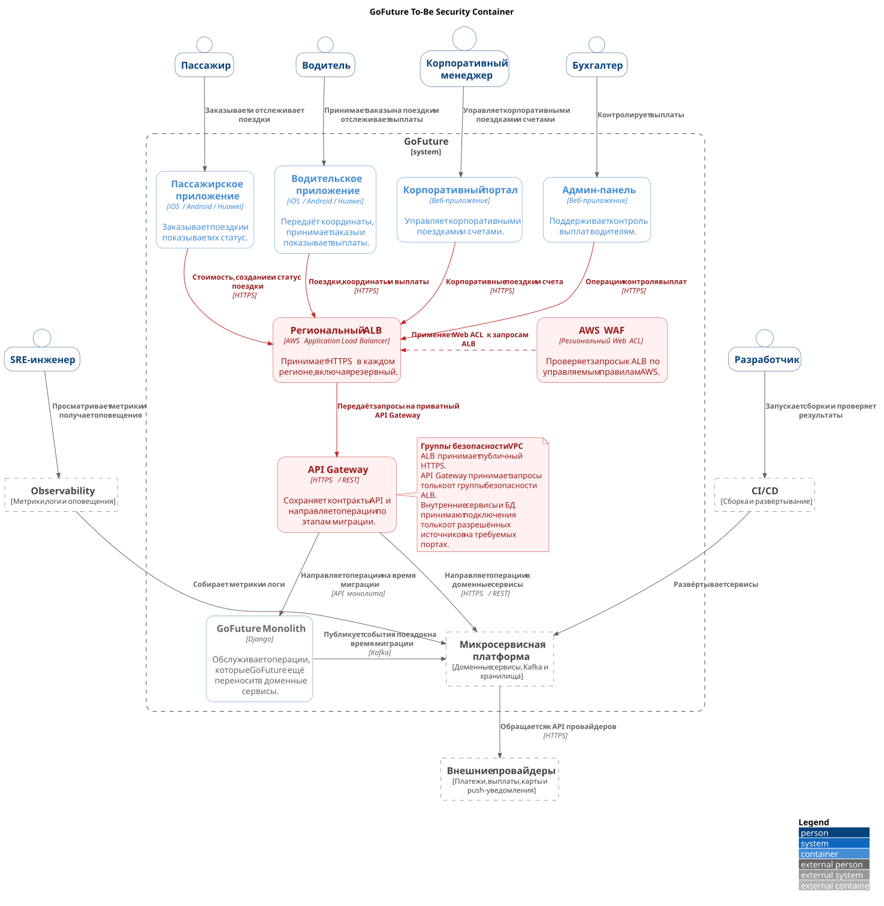

# Защита входящего трафика GoFuture

На диаграмме C2 красный цвет обозначает новые средства защиты и изменения в маршруте запросов. Приложения и порталы обращаются к API GoFuture по HTTPS через региональный Application Load Balancer (ALB).

GoFuture To-Be Security Container

GoFuture подключает **AWS WAF** к каждому публичному ALB, включая ALB резервного региона. AWS WAF проверяет запросы по набору AWS Managed Rules и блокирует запросы с признаками типовых веб-атак. При аварийном переключении AWS WAF применяет те же правила в резервном регионе. [AWS WAF](https://docs.aws.amazon.com/waf/latest/developerguide/what-is-aws-waf.html)

**Группы безопасности VPC** ограничивают сетевой доступ. Публичный ALB принимает запросы по HTTPS. Приватный API Gateway принимает подключения только от группы безопасности ALB. Поэтому клиенты обращаются к API через ALB с AWS WAF. GoFuture задаёт допустимые источники подключений и порты для сервисов и баз данных. [Группы безопасности ALB и его целевых ресурсов](https://docs.aws.amazon.com/elasticloadbalancing/latest/application/load-balancer-update-security-groups.html)

AWS обслуживает средства защиты. GoFuture настраивает правила фильтрации запросов и сетевого доступа. AWS Shield Standard обеспечивает базовую защиту от DDoS. [AWS Shield Standard](https://docs.aws.amazon.com/waf/latest/developerguide/ddos-standard-summary.html)
