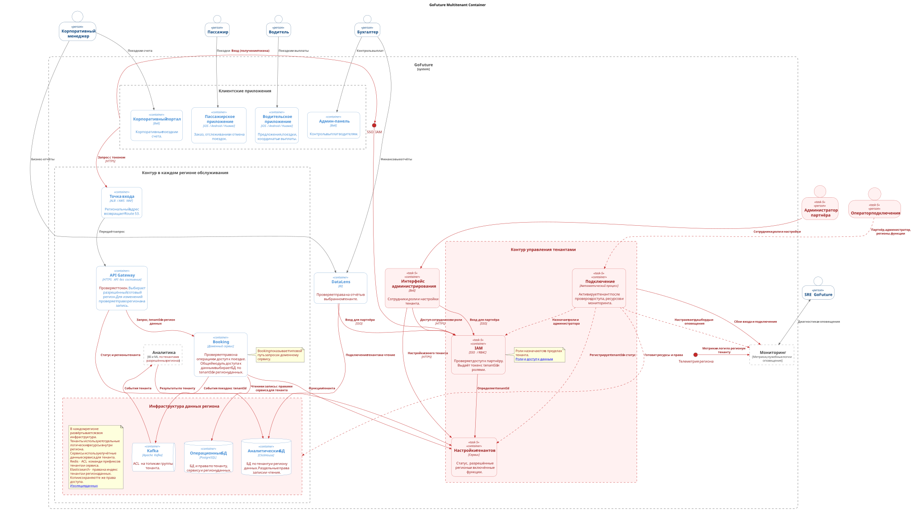

# Роли, доступ к данным и изоляция в мультитенантной платформе

Тенант представляет организацию-партнёра на платформе GoFuture. GoFuture определяет общие роли тенанта. Назначение роли пользователю действует в пределах конкретного тенанта.

Пассажир и водитель открывают ссылку партнёра. Бухгалтер выбирает одного из доступных ему партнёров. IAM аутентифицирует пользователя через SSO и выдаёт токен с идентификатором выбранного тенанта и ролями пользователя.

При обработке запроса приложение или сервис проверяет, разрешает ли роль запрошенную операцию. Затем проверяет, входит ли запись в область доступа пользователя.

GoFuture Multitenant Container

Красный цвет обозначает изменения задания 5. Пунктирные стрелки показывают операции подключения партнёра.

<table>
  <thead>
    <tr>
      <th scope="col" valign="top">Роль</th>
      <th scope="col" valign="top">Приложение</th>
      <th scope="col" valign="top">Данные и разрешённые операции</th>
      <th scope="col" valign="top">Область доступа</th>
    </tr>
  </thead>
  <tbody>
    <tr>
      <th scope="row" valign="top">Пассажир</th>
      <td valign="top">Пассажирское приложение</td>
      <td valign="top">Заказывает и отслеживает поездки. Отменяет поездки, если их статус допускает отмену</td>
      <td valign="top">Поездки этого пассажира в пределах тенанта</td>
    </tr>
    <tr>
      <th scope="row" valign="top">Водитель</th>
      <td valign="top">Водительское приложение</td>
      <td valign="top">Отвечает на предложения поездок, начинает и завершает поездки, передаёт координаты и просматривает выплаты</td>
      <td valign="top">Предложения, назначения, координаты и выплаты этого водителя в пределах тенанта</td>
    </tr>
  </tbody>
  <tbody>
    <tr>
      <th scope="rowgroup" rowspan="2" valign="top">Корпоративный менеджер</th>
      <td valign="top">Корпоративный портал</td>
      <td valign="top">Управляет корпоративными поездками и счетами через модуль Corporate сервиса Booking</td>
      <td valign="top">Корпоративные счета, которыми менеджер вправе управлять в пределах тенанта</td>
    </tr>
    <tr>
      <td valign="top">DataLens</td>
      <td valign="top">Просматривает бизнес-отчёты</td>
      <td valign="top">Отчёты по назначенным корпоративным счетам</td>
    </tr>
  </tbody>
  <tbody>
    <tr>
      <th scope="rowgroup" rowspan="2" valign="top">Бухгалтер</th>
      <td valign="top">Админ-панель</td>
      <td valign="top">Проверяет выплаты водителям через сервис Payouts</td>
      <td valign="top">Данные о выплатах по тенантам, к которым бухгалтеру предоставлен доступ</td>
    </tr>
    <tr>
      <td valign="top">DataLens</td>
      <td valign="top">Просматривает финансовые отчёты</td>
      <td valign="top">Финансовые отчёты по тенантам, к которым бухгалтеру предоставлен доступ</td>
    </tr>
  </tbody>
  <tbody>
    <tr>
      <th scope="row" valign="top">SRE GoFuture</th>
      <td valign="top">Grafana и Alertmanager</td>
      <td valign="top">Получает оповещения. По служебной телеметрии определяет, каких тенантов затронул сбой в регионе.</td>
      <td valign="top">Метрики состояния сервисов, служебные логи и оповещения по всей платформе. Телеметрия содержит регион и тенант, если эти сведения доступны.</td>
    </tr>
    <tr>
      <th scope="row" valign="top">Администратор партнёра</th>
      <td valign="top">Интерфейс администрирования</td>
      <td valign="top">Управляет доступом сотрудников и назначает роли. Изменяет настройки в ведении партнёра.</td>
      <td valign="top">Тенант, для которого назначена роль</td>
    </tr>
    <tr>
      <th scope="row" valign="top">Оператор подключения</th>
      <td valign="top">Интерфейс подключения</td>
      <td valign="top">Запускает подключение партнёра и отслеживает подготовку ресурсов</td>
      <td valign="top">Партнёры, за подключение которых отвечает оператор</td>
    </tr>
  </tbody>
</table>

## Изоляция данных тенантов

GoFuture развёртывает отдельную инфраструктуру данных в каждом обслуживающем регионе. Тенанты региона используют эту инфраструктуру совместно. Сервис подключения выделяет каждому тенанту отдельные логические ресурсы и настраивает права доступа к ним.

Сервисы подключаются к этим ресурсам с учётными данными сервиса для тенанта. Права учётной записи определяют доступные сервису ресурсы и операции. В этих пределах сервисы обрабатывают данные о поездках и платежах, а также персональные данные.

При репликации и восстановлении GoFuture применяет к копиям те же правила доступа. Копии обслуживают запросы после применения этих правил и только в согласованных регионах.

<table>
  <thead>
    <tr>
      <th scope="col" valign="top">Система</th>
      <th scope="col" valign="top">Ресурс тенанта</th>
      <th scope="col" valign="top">Контроль доступа</th>
      <th scope="col" valign="top">Нагрузка и доступность</th>
    </tr>
  </thead>
  <tbody>
    <tr>
      <th scope="row" valign="top">PostgreSQL</th>
      <td valign="top">Отдельная логическая БД для каждого сочетания тенанта, сервиса и региона данных</td>
      <td valign="top">Сервис выбирает БД по проверенному идентификатору тенанта и региону данных. Права учётной записи разрешают только необходимые операции в этой БД.</td>
      <td valign="top">В каждый момент один регион имеет право записи в БД. При аварийном переключении GoFuture передаёт право записи реплике в согласованном резервном регионе.</td>
    </tr>
    <tr>
      <th scope="row" valign="top">Kafka</th>
      <td valign="top">Отдельные топики и группы потребителей для потоков данных каждого тенанта</td>
      <td valign="top">ACL брокера дают каждой учётной записи сервиса доступ к нужным топикам и группам одного тенанта. Обработчики используют <code>tenantId</code> из события, чтобы обработать данные в пределах того же тенанта. <a href="https://kafka.apache.org/42/operations/multi-tenancy/">Мультитенантность в Kafka</a></td>
      <td valign="top">Число партиций зависит от нагрузки потока. Квоты клиентов ограничивают конкуренцию за ресурсы. GoFuture реплицирует топики внутри региона. Для восстановления после отказа региона GoFuture копирует топики в согласованный резервный регион. Правила передачи определяют, какие топики можно копировать.</td>
    </tr>
    <tr>
      <th scope="row" valign="top">Redis</th>
      <td valign="top">Префикс ключей для каждого сочетания тенанта и сервиса в региональном кеше</td>
      <td valign="top">ACL Redis ограничивают префикс ключей и команды кеша для каждой учётной записи сервиса. <a href="https://redis.io/docs/latest/management/security/acl/">ACL в Redis</a></td>
      <td valign="top">Сервисы используют региональный кеш, задают срок жизни записей (TTL) и ограничивают рост кеша. Pricing может применять базовые правила, пока восстанавливает кеш из Kafka.</td>
    </tr>
    <tr>
      <th scope="row" valign="top">Elasticsearch</th>
      <td valign="top">Индекс координат водителей для каждого сочетания тенанта и региона данных</td>
      <td valign="top">Geography использует учётные записи с правами на поиск и индексирование только в индексе тенанта. <a href="https://www.elastic.co/docs/reference/elasticsearch/security-privileges">Права на индексы в Elasticsearch</a></td>
      <td valign="top">Размер и число шардов зависят от частоты обновлений координат и запросов поиска. В согласованных резервных регионах Geography поддерживает индекс по копиям событий координат. Перед началом поиска в резервном регионе сервис проверяет актуальность координат.</td>
    </tr>
    <tr>
      <th scope="row" valign="top">ClickHouse</th>
      <td valign="top">Отдельная логическая аналитическая БД для каждого сочетания тенанта и региона данных</td>
      <td valign="top">Analytics записывает данные с правами на БД тенанта. DataLens подключается к этой БД с правами только на чтение. DataLens проверяет доступ к отчётам по правилам в таблице ролей. <a href="https://clickhouse.com/docs/reference/statements/grant">Права доступа в ClickHouse</a> · <a href="https://yandex.cloud/en/docs/datalens/security/row-level-security">Доступ к данным на уровне строк в DataLens</a></td>
      <td valign="top">GoFuture обрабатывает запросы BI отдельно от запросов на поездки. GoFuture ограничивает число одновременных запросов BI, чтобы сохранить ресурсы для загрузки данных.</td>
    </tr>
  </tbody>
</table>
